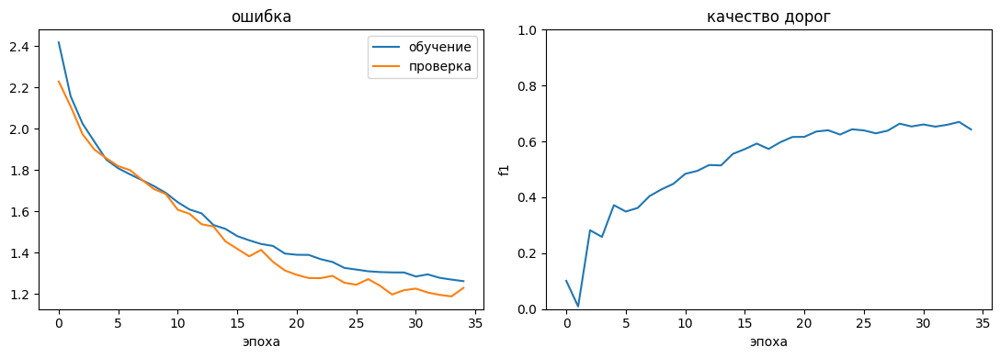
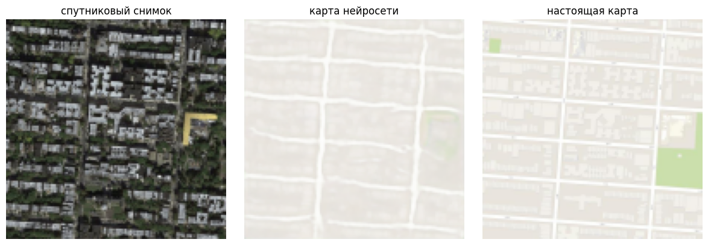
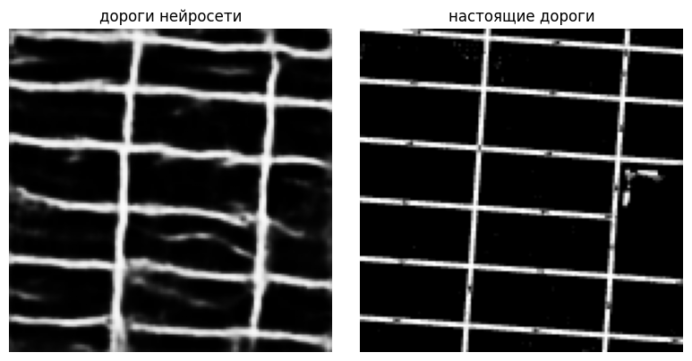

# технологии искусственного интеллекта

в этом репозитории находится вторая лабораторная работа по предмету "технологии искусственного интеллекта". работа выполнена на python в формате jupyter notebook.

## лабораторная работа 2

в работе рассматривается построение схематической карты по спутниковому снимку. для обучения используется набор парных изображений maps.

нейросеть построена на основе u-net и отдельно выделяет дороги. при обучении учитывается ошибка изображения и качество обнаружения дорожной сети. результат оценивается с помощью метрики f1.

## запуск

ноутбук `Lab2.ipynb` можно открыть в pycharm или jupyter notebook. для работы используются pytorch, numpy, opencv и matplotlib.

```bash
pip install torch numpy opencv-python matplotlib
```

архив `maps.tar.gz` нужно положить в папку `data` рядом с ноутбуком. после запуска программа подготовит изображения, обучит модель и сохранит результаты в папку `results_roads`.

## результаты

обучение проводилось на 450 изображениях. на проверочной выборке из 40 изображений получено значение f1 около 0.67. нейросеть выделяет основные дороги, но некоторые линии получаются шире исходных.






